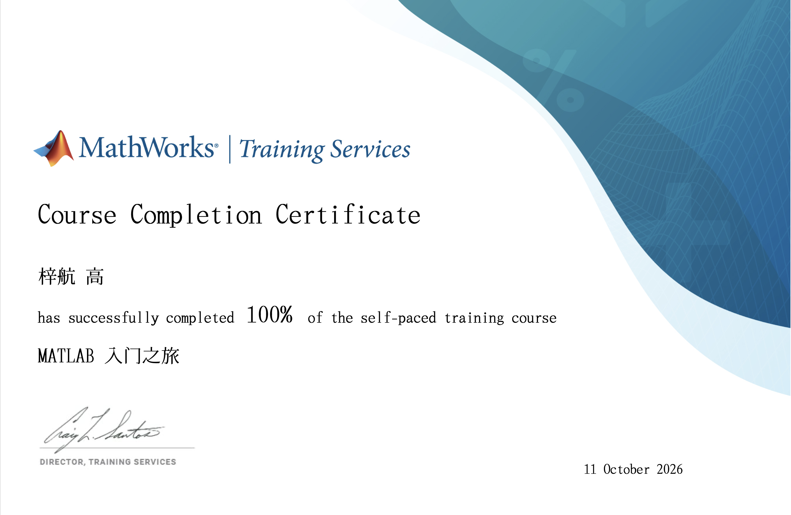

# matlab-90days

My 90-day MATLAB learning log.

- **学校:** 上海交通大学 · 浦江国际学院
- **专业:** 电子与计算机工程 · 大一
- **起点:** 零基础，始于 2026-10-10

## 证书

**MATLAB 入门之旅（MATLAB Onramp）— 100% 完成 · 2026-10-11**

## 学习记录

| 周次 | 日期 | 内容 | 文件 |
|:---:|:---|:---|:---|
| **W1** | 10/10–10/11 | **MATLAB Onramp 通关（100%）** ✅ | `first_script.m` · `w01_triangle.m` |
| W2 | | 向量化与函数化 | |
| W3 | | 用 MATLAB 重做已手算的作业题 | `w03_*.m` |

## 路线

- [x] MATLAB Onramp（14 个模块，约 2 小时）
- [ ] 向量化与函数化
- [ ] 数据导入与绘图
- [ ] Simulink 入门
- [ ] 综合工程练习
